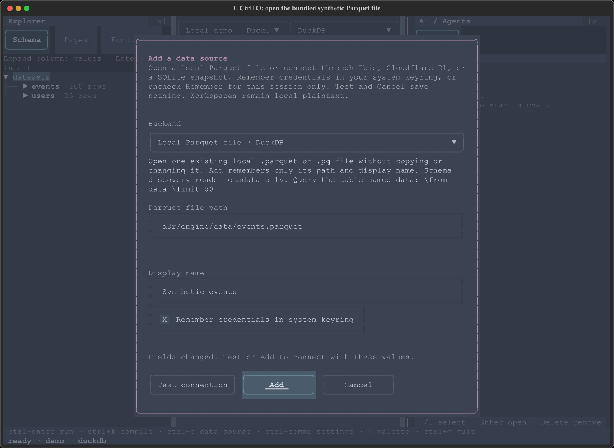

# D8R

**Public alpha · 0.1.0a1** — a keyboard-first terminal workspace for exploring
local data and writing structured queries. Pronounced “Datuhr”.

D8R combines a schema explorer, context-aware completion, source-specific saved
query pages, reusable functions, and a results grid with CSV export. It is for
analysts and developers who want to explore tables from the terminal and are
willing to try a small query language instead of a general-purpose SQL editor.

Start with the bundled synthetic data or a local Parquet file. Remote connectors
are available, but a connector or SQL dialect appearing in a picker is **not** a
promise of live-backend compatibility. This is an early release, not a claim of
production readiness. See the [tested matrix and known limits](docs/ALPHA.md).



[Reproduce the demo](docs/DEMO.md) · [Full user guide](docs/USER_GUIDE.md) ·
[Alpha support and feedback](docs/ALPHA.md)

## Why a backslash language?

The `\` prefix gives the editor an explicit command and completion context:
choose a table after `\from`, columns after `\select`, and a column, operator,
then values after `\where`. The same structured document supports editing,
validation, saved queries, and parameterized functions.

D8R parses that document into an AST and builds
[Ibis](https://ibis-project.org) expressions. The **document**, **data source**,
and **SQL rendering dialect** are separate choices:

- The source supplies the schema and the connection used by **Run**.
- The dialect selects SQL rendering for **Compile**, which does not execute the
  query or move it to another database.
- Backend and expression support still vary; SQL compilation is not evidence of
  successful execution on a vendor's service.

This is deliberately **not an arbitrary SQL editor**, and the language does not
cover every SQL feature. [The language contract](docs/AST.md) and
[compatibility reference](docs/COMPATIBILITY.md) describe its scope. The terminal
interface is built with [Textual](https://textual.textualize.io); no browser or
application server is needed.

## Install the alpha and run a query

Install Git and [uv](https://docs.astral.sh/uv/getting-started/installation/),
then clone and select the alpha tag:

```bash
git clone https://github.com/harryvgiunta/d8r.git
cd d8r
git checkout v0.1.0-alpha.1
uv sync --locked
uv run d8r
```

Python **3.13 or newer** is required; the repository pins its development Python
in `.python-version`. `uv` creates a project-local `.venv` using `uv.lock`.
For release-wheel installation and platform-specific qualifications, see
[the alpha guide](docs/ALPHA.md).

A fresh workspace opens on **demo**, backed by bundled synthetic Parquet data
and an in-process DuckDB engine. No database account or AI provider is needed.
Try this query against that source:

```d8r
\from events
\select event_type, count(*) as event_count
\group event_type
\order event_count desc
\limit 10
```

Press **Ctrl+Enter** (or **F5**) to run it and view the event counts. Press
**Ctrl+K** (or **F6**) to compile it to SQL without executing it. Type `\` to
open completion; **Enter** or **Tab** accepts a suggestion. **Ctrl+Q** quits
from the query workspace. The [demo walkthrough](docs/DEMO.md) provides the
reproducible workflow behind the image above.

## Open your own local Parquet file

1. Press **Ctrl+O** and choose **Local Parquet file · DuckDB** under **Backend**.
2. Enter an existing `.parquet` or `.pq` file path, then choose **Add**.
3. The file appears as the table `data`. Start with:

   ```d8r
   \from data
   \limit 50
   ```

4. Press **Ctrl+Enter**. Use the schema explorer and completion to choose columns,
   then save query drafts in **Pages** or use **Export CSV…** in Results.

This entry path accepts one local file, not a URL, directory, or glob. Queries
read it through DuckDB/Ibis without modifying the original file. The file is not
uploaded by opening it; optional AI sharing is a separate boundary below.
See [local file behavior](docs/USER_GUIDE.md#open-a-local-parquet-file) for
persistence and reconnection details.

## Optional AI and privacy

AI is **not required** to load data, edit, compile, or run queries. To enable it,
open **Settings → AI provider** and configure an OpenAI-compatible Chat
Completions endpoint, model, and key. D8R does not host a provider.

Sending a message shares the current document or function draft with your chosen
provider. The assistant can also request schema/capability information, recent
successful queries, and saved function definitions. **Allow Sample Data**,
**Test AI Queries**, and **Automatically Apply AI Edits** are off by default.
Opting into samples can send data values; opting into query tests permits bounded
read-only execution. Turning a permission off does not erase previously shared
conversation context. Use HTTPS for remote providers and review their policies.

Leave AI unconfigured when that context must remain local. Credentials use the
OS keyring when remembered, but local query history, chats, drafts, and connection
metadata are **plaintext** under `~/.d8r` (or `D8R_DATA_DIR`). Protect those files,
backups, exports, and diagnostic logs. Read the
[AI permissions](docs/USER_GUIDE.md#ai-assistance) and
[storage reference](docs/USER_GUIDE.md#configuration-and-backups) before use.

## Limits, safety, and feedback

D8R runs with your user account's permissions; it is **not a sandbox**. Use
trusted files and least-privileged database roles. Row limits cap returned rows,
not query cost. Remote databases require their own infrastructure, drivers, and
appropriate TLS configuration. Vendor-shaped bundled sources are **mocks** that
execute locally, not live connections to those vendors.

Windows/Python 3.13 is the exercised native path for this alpha. macOS/Linux have
not been exercised; PostgreSQL opt-in integration tests were not run; D1 HTTP
coverage is mocked with SQLite; generic adapters are not live-certified. The
[alpha guide](docs/ALPHA.md) is the support matrix and known-limit reference.

Report bugs and usability feedback through
[GitHub Issues](https://github.com/harryvgiunta/d8r/issues). Include the alpha
version, OS/Python/terminal, backend, a minimal reproduction, and expected versus
actual behavior. Remove credentials, private queries, schema, and data before
sharing logs or screenshots. See [feedback guidance](docs/ALPHA.md).

The [full user guide](docs/USER_GUIDE.md) retains the detailed keyboard, workspace,
language, functions, connections, AI, configuration, and developer references.

## License

[MIT](LICENSE) · Copyright (c) 2026 Harry Giunta.
