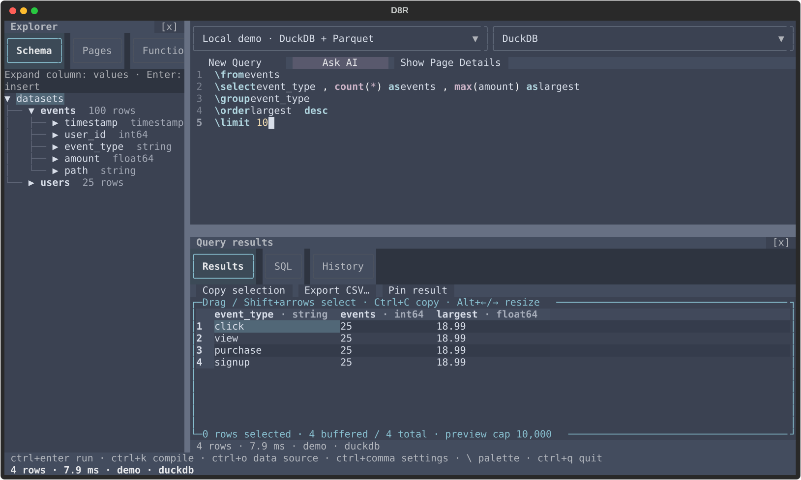

# D8R user guide

Detailed usage reference for the **0.1.0a1 public alpha**. Start with the
[README](../README.md) or [demo walkthrough](DEMO.md). See the
[alpha support matrix and known limits](ALPHA.md) before choosing a backend.
This guide describes available interfaces, not certification of every platform
or connector. Run shell commands from the repository root unless stated otherwise.



Pronounced “Datuhr” — a playful take on “data”.

**A keyboard-first terminal workspace for D8R queries and supported data sources.**

Explore local data or query a real database without leaving your terminal.
D8R combines a schema explorer, saved query workspaces, contextual completion,
and a results grid with CSV export. Optional AI assistance uses a provider you
configure; it is not required to load data or run queries.

Built with [Textual](https://textual.textualize.io) and
[Ibis](https://ibis-project.org): the short `\command` language builds real
database expressions, not a simulated results view. D8R starts no server and
needs no browser. `uv run d8r` launches the app; remote databases require their
own reachable server and backend drivers.

## The model

Three axes, orthogonal by design:

```
document  →  datasource (which schema it points at)  →  dialect (what SQL it becomes)
    │                          │                                │
    └──────────── compile (never executes) ──────────────────────┘
                               └──────────── run ───────────────┘
```

- **The document is the source of truth.** A short clause language (`\from`,
  `\join` — inner, derived-table and `\join lateral`, `\union`, `\intersect`,
  `\except`, `\select`, `\where`, `\group`, `\order`, `\case`, `\limit`,
  `\with`) parses to a pure AST, and the statements a query cannot carry —
  `\temp`, `\drop`, `\begin`, `\savepoint`, `\release`, `\rollback`, `\commit` —
  parse beside it. Query expressions are built through Ibis; this is not an
  arbitrary SQL editor.
- **The datasource is the schema context.** Pick one and the schema tree,
  completion, and validation all follow it. The bundled registry holds a live
  demo source and four vendor-shaped mock connections; sources you add yourself
  join the same picker.
- **The dialect is a rendering choice.** The SQL tab renders the document for
  the selected target without executing it. Rendering depends on the query and
  Ibis/backend capabilities; it does not establish that a remote database can
  execute that query. PySpark requires a live session configuration rather than
  offline compilation. See [compatibility](COMPATIBILITY.md) and the
  [alpha support matrix](ALPHA.md) for the distinction between compilation,
  local execution, and live-backend verification.

## Install and run

Install [uv](https://docs.astral.sh/uv/getting-started/installation/) and Git first,
then run these commands in your terminal:

```bash
git clone https://github.com/harryvgiunta/d8r.git
cd d8r
git checkout v0.1.0-alpha.1
uv sync --locked  # create the project environment (.venv) from the lockfile
uv run d8r    # launch the IDE
```

Dependencies are declared in `pyproject.toml` and locked in `uv.lock`; nothing
is installed globally, and every command runs in the project's `.venv`. Python
`>=3.13` is required (pinned in `.python-version`). `uv run python -m d8r` is
the equivalent module form.

A fresh session opens on the `demo` source with a real query already in the
editor, so `ctrl+enter` does something true on the very first keystroke.

**Bring your own data:** [open a local Parquet file](#open-a-local-parquet-file)
or [connect PostgreSQL](#add-a-postgresql-database). Both use the same schema
explorer, query editor, results grid, and source-specific saved pages.

### Running safely on your machine

D8R is a local application, **not a sandbox**. It runs Python and native database
drivers with your user account's permissions. Use trusted data files, keep the
environment updated, and run it as a normal user rather than as administrator.

- The bundled demo runs offline. Remote database connections contact the server
  you choose; optional AI sends context to the provider you configure. Leave AI
  unconfigured if your queries or schema must stay local.
- Use a **read-only database role** for review. For remote PostgreSQL, prefer
  **`verify-full`** with your provider's certificate configuration; the form's
  default `prefer` does not guarantee encryption or verify the server.
- Saved passwords/API keys use the **OS credential store**, through Python's
  `keyring` library. Query history, AI chats, and connection metadata remain
  plaintext under `~/.d8r` (or `D8R_DATA_DIR`); protect them and exported results.
  See [Configuration and backups](#configuration-and-backups).
- Row limits bound returned data, **not query cost**. Large files, joins, and
  aggregations can still consume substantial memory, CPU, disk, or database
  resources. Start with small queries and appropriate database-side limits.

## The screen

- **Header** — the datasource and dialect pickers, without a logo or backend banner.
  Switching source restores that source's
  workspace: its last query page and caret, function library/draft, and agents.
  Switching dialect changes SQL rendering, not workspace ownership.
  **New Query**, immediately before **Functions**, opens a blank page and keeps the current draft.
- **Schema / Pages explorer** — Schema lists the active source's datasets and
  column types. Expand a column to inspect up to 1,000 distinct values, including
  NULL, without changing the document or execution history. Enter on a column
  still inserts its name. PostgreSQL row counts remain unloaded to avoid scans.
  **Pages** lists editable query drafts only for the selected connection. Its search box filters
  case-insensitively by query text, page name, or description without changing the
  current query. New, Duplicate, Delete and reopening preserve source/dialect and
  chat identity; Delete acts on the highlighted row. Each page shows two lines
  (title, then source), truncated to the pane's width. Existing successful
  history seeds pages when upgrading. `\pages` and `\queries` reveal Pages; using
  either again while Pages is visible hides the explorer. Switching pages never runs
  a query or connects a database.
- **Right-side AI / Agents tabs** — Agents lists the active source's query and function chats and status counts; select one to reopen its
  transcript and composer. `ctrl+j` or an **Agents** button reveals this tab
  without leaving the query or function editor.
- **Document pane** — the editor (line numbers on), with the `\` palette
  floating under the caret.
  **Show Page Details / Hide Page Details** toggles the current page's name and
  description fields, both autosaved with the draft. **Generate with AI** sends
  only the current query text to the configured AI provider and saves the generated
  name and description; it never edits or executes the query. Cancel, a page switch,
  or changed query/details prevents an in-flight response from overwriting edits.
- **Results / SQL / History tabs** — Results shows the executed rows, or the
  parser/engine error line when a run is refused; SQL shows the compiled
  document for the active dialect (read-only, never executed); History lists
  saved successful runs across sessions; selecting a row restores its document,
  source target and dialect without executing it or reconnecting automatically.
- **Footer** — the key hints, and a status line that reports what just happened
  (rows, milliseconds, source, dialect).

Query and function editing share these slots. **Functions** (or `\fn`) replaces
the Schema tab's contents with the function library, the document with the function
form, and query results with a function preview. **Query** or `ctrl+q` returns to
the unchanged document. **Ask AI** opens the same assistant on the right in either
mode; it never takes over the form.

Drag the separators to resize the explorer, assistant, and editor/output split.
Click a separator and use Left/Right or Up/Down for one-cell adjustments; hold
Shift for five cells. Escape cancels a drag. Sizes stay put when changing modes
and persist in `settings.json` as `pane_sizes` (`explorer`, `ai`, `editor`, in
terminal cells). Smaller terminals temporarily clamp panes; enlarging restores
your preferred sizes.

IntelliSense continues after `AND`/`OR`, including nested conditions and inline
aggregate filters. Tab accepts the current suggestion only; with no suggestion it
does not insert indentation or move focus in the query editor.

Filtered aggregates keep the query's input rows while filtering each reduction:

```d8r
\from events
\select user_id, sum(amount \where event_type = 'purchase') as purchases, count(* \where event_type = 'click') as clicks
\group user_id
```

Each aggregate has its own predicate; ordinary `\where` still filters the entire
query before grouping. See [the AST contract](AST.md) for predicates, arithmetic
and window support.

### Settings

Open Settings with `ctrl+comma` or the `\settings` palette action. A persistent
left sidebar lists General, Show/Hide Menus, Theme, Value cache, Data source,
Dialect, AI provider, and Keybindings. Highlighting a category displays its options and explanation
in the center without changing a setting.

Use Up/Down to browse, Enter or Right to focus the category's controls, and
Enter or click a row to toggle, select, or edit it; the footer names the action
for the current category. Tab/Shift+Tab switch panels; Left or Escape returns
to the sidebar without losing the selected category. Escape from the sidebar
closes Settings. Connection and provider forms return to the same page and row.

**Colors and themes:** select **Settings → Theme**. Each palette has color
swatches and a light/dark label. Enter or click a theme to apply it immediately
and save it for next launch; no restart or separate Save is needed. **Nord**
is the default; an existing saved theme is preserved. Alternatives include
Cozy Pastel, Dracula, Catppuccin, and terminal ANSI
palettes. Dropdowns, completion menus, editors, and results follow the selected
theme. Changing colors never edits or runs your document. The saved JSON key is
`"theme"` (for example `"cozy-pastel"` or `"nord"`). `NO_COLOR` remains respected;
unset it in your terminal environment if you want colors.

The query editor and function-body editor color D8R commands, keywords, function
calls, quoted strings, numbers, `@parameters`, and operators as you type. Colors
follow the chosen theme, including on the current line. Quoted text is kept as
one token; unfinished input stays editable. Coloring never changes validation,
completion, selection, undo, or query execution. Agent status labels also follow
theme changes without retaining a background from the previous palette.

**Show/Hide Menus → agents tab** and **AI pane (right)** hide their respective
tabs. The shared **[x]** above AI / Agents closes the entire right pane and its
splitter, from either tab. These preferences survive restart; drafts and running
requests are preserved. `ctrl+j` reopens Agents; **Ask AI** reopens the chat.

Preferences are loaded from `~/.d8r/settings.json` and saved when changed.
You can also edit the JSON while D8R is closed; restart to load edits. Settings
shows the actual file path. See [Configuration and backups](#configuration-and-backups)
for the directory override, file format, and credential handling.

**General → Default rows returned** starts at **50**. Save a whole number from
0 to 1,000,000; **0 disables the default**. Ordinary Run and Compile apply it only
when the top-level query has no explicit `\limit`. An explicit `\limit`, including
`\limit 0`, wins. The document and AST remain unchanged. Temporary-table creation
uses exactly the query's own limits, and AI sample reads keep their separate cap.
The results pane's independent 10,000-row preview buffer still applies.

### Workspace recovery

The query pages (name/description/document/caret/stable identity/source/dialect), selected
explorer tab, last workspace or function view, unsaved function draft/target,
query history, and target-scoped AI chats are autosaved to `workspace.json`. Query and function
editing saves after an idle pause, not during held-key repeats; latest widget contents
are flushed on exit, including an unsent AI message. Function drafts
remain drafts: the form's **Save**/**Run preview**, an explicit **Save function** on
a workspace AI preview proposal, or a user-requested direct save from main chat
changes the function library. Autosave alone never promotes a draft.

Each connection owns its functions, pages, history, completion history and agents under
a stable identity. Pages search and History never include another connection's entries;
functions cannot call definitions belonging to another connection. Switching away flushes
current drafts; switching back restores the last page, caret, function draft and view
without executing anything. Results, SQL and pinned data tabs remain connection-local
in memory, and do not persist across restarts. A new connection starts with an empty page.
Selecting a disconnected connection switches workspaces immediately, before background
reconnection finishes. Failure or Cancel leaves that workspace selected and editable.
Reconnecting the same target preserves edits made while connecting. Other connections'
chats and requests remain alive; switching does not mark their hidden replies read.

Session restoration opens no database connections, runs no queries and sends no
AI requests. After the UI mounts, only the selected saved target reconnects in
the background, without executing its document. Other saved targets remain
**disconnected** until selected or used. Press **Run** (`ctrl+enter` or `f5`) to
reconnect and execute the submitted document against that same target. Saved
credentials and snapshot paths use compact blinking dots, Cancel and a
**30-second timeout**, not estimated database progress. Cancel, timeout, or a
target change prevents late registration or execution. Missing credentials open the connection form; connection
failures report in the status line. The draft never silently runs against demo data.
Changing connection details to another target requires a fresh Run.
The header's **Reconnect** button and source pickers still connect without running
a query. `ctrl+o` opens the add-source form without connecting just by opening it;
a restored snapshot path is prefilled.
Result grids, temporary tables, transaction state, diagnostic logs, in-flight
requests, and applicable AI proposals are not restored. A restored conversation
can continue on Send, using freshly captured context and validation.

## AI assistance

Open Settings with `ctrl+comma`, select **AI provider**, then press Enter or click
**Endpoint**, **Model**, **API key**, **AI turns/tool rounds**, **Tool calls per round**,
**Sample records per read**, **Maximum attempts**, or **Request timeout**.
The provider form opens with that field focused. Edit an OpenAI-compatible
**Chat Completions** base URL (including `/v1`), model, and masked API key, then
choose **Save**. Leave **Remember** enabled to save the key in your system keyring;
turn it off to use this provider configuration for the current session only.
**Cancel** or Escape discards form changes.
A full `/chat/completions` URL also works. This calls your provider;
D8R does not host an endpoint or use OMP as a dependency. The separate OpenAI
Responses API is not supported by this adapter.

For the existing yolo setup, **Import yolo key** fills `https://yolo-auto.com/v1`,
model `yolo`, and `YOLO_AUTO_API_KEY` from the environment or
`~/.omp/agent/.env`. Import only fills the form; **Save** applies it. It never
modifies `.omp`. Manual configuration supports other compatible providers.
Use HTTPS for remote providers: HTTP sends the key and conversation unencrypted.

- Type `\AI` in the document and accept the palette action with Enter. The
  assistant opens alongside the editor; the command is not query text.
- Enter in the chat input, **Send**, or `ctrl+enter` sends your message.
  Responses stream into the conversation; **Cancel** aborts a pending request,
  and Escape/**Close** hides the assistant and returns focus to the editor.
  Tab/Shift+Tab navigate chat controls while focus is inside the assistant.
  Hiding chat, switching chats, or closing the function editor does not cancel work.
- Sending again while a response is in flight **interrupts and steers** that chat.
  D8R restarts the provider turn with the original request, completed exchanges,
  and your new instruction. Partial replies/tool batches are discarded, not applied.
  A context read already running finishes before the replacement turn starts;
  completed function saves remain and are reported.
- Ask the workspace AI to **create, make, edit, or apply queries** and it returns
  complete proposals, without asking a separate permission question. **Apply**
  updates the current draft; **Apply queries** applies every labeled page: the
  first replaces the active draft and the others become new pages on the same
  source/dialect. With **Automatically Apply AI Edits** enabled, validated proposals
  apply automatically. Unrelated pages, results and history stay unchanged.
  Neither path runs queries or saves functions. Explanatory answers remain prose.
  Invalid, incomplete, cancelled, or stale proposals cannot be applied. Changing
  the document or function draft makes its proposal stale without losing the reply;
  switching sources or targets selects that target's saved chat.
- **Settings → AI provider → Allow Sample Data** is off by default. Enable it to
  let the AI read bounded sample records from registered tables.
- **Allow Schema Refreshes** is on by default. It controls the AI's schema and
  backend-capability lookups, not normal IDE schema indexing.
  These permissions save immediately. Disabled tools are withheld from new requests
  and denied in existing ones; disabling samples also discards pending sample results.
  Enabling a tool makes it available on the next message. Previously shared context
  remains in chat history; disabling a permission does not erase it.
- **Test AI Queries** is off by default. Enable it to let the AI test each proposed
  read-only D8R query against the chat's source, inspect execution failures and
  bounded row counts, and revise its proposal before replying. Successful checks
  with zero rows are reported honestly; filters are not loosened just to get data.
  The IDE reports whether the exact final draft was checked, failed, or remains
  unchecked, independently of the model's claims. Tests do not edit the document
  or change the results pane/history. **Allow Sample Data** separately permits
  sharing up to 20 result columns with the provider; it is not required for
  execution success/row-count evidence. Checks honor smaller explicit limits,
  including zero, and cap larger/unlimited queries at **Sample records per read**.
  This caps returned rows, not scan cost or full-result correctness. Transactions,
  temp/drop commands, multiple statements, disconnected sources, and checks during
  an open transaction are refused. Cancel/timeout ends the AI wait, but an already
  running database read retains its connection reservation until it finishes.
  Disabling checks rejects pending results; it cannot undo a read already started.
- **Automatically Apply AI Edits** is off by default. Enabling
  it persists immediately and applies complete, validated proposals only while
  their target draft is unchanged. It never executes queries or saves functions.
  This preference controls query edits; explicit saved-function requests remain separate.
- Ask the main assistant to create, edit, save, or apply a saved function by name.
  It calls `save_function` to validate and persist the requested definition
  directly; “apply it” after a function proposal also authorizes this save.
  No **Apply**/**Save function** click, function-form switch, or auto-accept toggle
  is required. The query and current mode stay unchanged, and nothing executes.
  Questions and requests to preview or draft a change do not authorize saving:
  review the proposed signature, description, example call, and body, then use
  **Save function** or ask the assistant to apply it.
  A stale source/target, cancelled or superseded request, changed/deleted original,
  or newly occupied name blocks saving; ask again with fresh context. AI edits
  preserve saved names. A save that already completed remains saved and is reported
  in chat/status even if the provider's subsequent response fails or is cancelled.
- In the function form, **Ask AI** opens that same right-side panel. Nothing is
  sent until Enter/**Send**. No fields need filling first. **Apply** fills the
  draft without saving or executing, keeps the chat open, and leaves the form
  visible. Use the form's **Save** or **Run preview** when ready.
- Genuine follow-up questions use an in-chat choice card with **Other** for custom
  answers. After answering, the question, choices and your answer stay visible in
  conversation history, including after switching chats, restarting, or a later
  provider failure. The AI continues with a proposal, not another permission question.
- **New chat** starts another conversation without deleting the current one.
  **[x]** hides the entire AI / Agents pane; Escape in the chat hides just its tab. Drafts are preserved.
- **Settings** in the shared chat panel opens provider configuration directly and
  returns to your unsent request. Permission toggles are in the main Settings menu.
- **New chat** preserves previous conversations and lets multiple requests run
  concurrently, even for the same target. **Agents** (`ctrl+j`) opens the right-side
  **Agents** tab, which lists chat history in an oh-my-pi-style roster: coloured
  status markers, bold names, muted target/activity details and live status counts.
  **Busy** means a request is running; **Ready** means a new chat or an unread
  completed reply; **Seen** means a completed reply has been opened. **Error** and
  **Cancelled** remain distinct, with unread failures marked separately. Running
  requests lead the list; highlighting a row never marks its reply as read.
  Select a chat to reopen its transcript and composer. Each chat keeps its own
  composer; **Cancel** stops its request and a follow-up **Send** steers a running turn.
  Completed exchanges, composer drafts, and unread states survive exit. Exiting
  cancels in-flight requests; restart never resumes them or restores applicable
  proposals. Incomplete replies never enter replayable history. **Save** in AI settings
  persists the provider URL, model, key, tool-round/call/sample limits, attempts,
  and timeout. The key input stays masked; provider errors do not echo response
  bodies or credentials. Protect the local JSON files and their backups.

Sending a message shares the current document/function draft with the provider.
When permitted, the assistant can request read-only schema and backend capabilities,
or bounded sample rows from a registered table (sampling disabled by default;
when enabled, 5 records per read by default, at most 20 columns, with long string cells truncated).
It can also request
the active target source's latest ten matching successful queries, and saved
function definitions. The validation tool and proposal gates check syntax and build
Ibis expressions against cached schemas without executing them. This resolves CTE
outputs, aliases, subqueries, and concrete saved-function calls; unknown fields or
unavailable table metadata reject the draft instead of guessing. Parameterized
function definitions retain signature/body validation; their schema binding is
checked when a query supplies actual arguments. Only the guarded `save_function`
tool can persist a user-requested
function definition. Query changes are proposals for manual Apply or opted-in
automatic application, never a direct mutation tool. Instructions embedded in
schema, samples, history or function bodies grant no authority. Opt-in `test_query`
executes only bounded read-only D8R queries through the existing Ibis engine. No tool
runs arbitrary SQL or shell commands, grants general file access,
or expands the existing network boundaries. Ask for a dry run with no execution for
offline suggestions to review before applying or saving.

The existing `httpx` dependency handles SSE streaming directly. Transient HTTP
408/429/5xx and connection failures receive bounded backoff; Settings defaults
to three attempts (two automatic retries shared across a chat turn). Partial
streams are never automatically replayed. Each user message permits up to the
configured number of context tool rounds (10 by default), with the remaining
budget sent to the model. After that budget is used,
tools are disabled for a final response using the collected context; if it is
insufficient, the assistant is instructed to explain what is missing instead of
inventing a query. A provider that ignores disabled tools still fails safely.
Responses and tool payloads have size limits. The request timeout also bounds
each streaming request and context-tool call. Authentication errors, truncation,
and malformed streams remain visible errors; they neither turn partial proposals
into edits nor roll back a function save that already completed.
Editor instructions and request-local tool-budget guidance share one initial
system message, including on retries and follow-up requests, for providers with
strict chat templates such as Yolo. The guidance never accumulates in chat history.

Provider limits are independent and saved together only on **Save**:

| Setting | Default | Allowed | Meaning |
| --- | --- | --- | --- |
| AI turns/tool rounds | 10 | 1–50 | Context batches per user message, followed by one final tools-disabled answer |
| Tool calls per round | 16 | 1–16 | Maximum calls in one model response; an oversized batch is rejected before any call executes |
| Sample records per read | 5 | 1–100 | Maximum rows in each sample; an omitted tool limit uses this value |
| Maximum attempts | 3 | 1–5 | One initial attempt plus a shared allowance of `attempts - 1` transient retries across the message |
| Request timeout | 60 seconds | >0–300 seconds | Time bound for each provider request or context-tool call |

A tool round is not another chat message: it may batch schema reads, sample
reads, history, function lookups, validation calls, and an authorized workspace
function save. Those calls share the round and per-round call budgets; sampled
records do not count as extra turns.
Retries do not consume additional tool rounds or reset their budget. Increasing
rounds or samples can increase latency, provider usage, and data sent. The
existing 20-column, 500-character string-cell, and 256-KiB tool-result limits
still apply; oversized results fail safely rather than bypassing the byte cap.
Limits are captured when sending a message; settings changes affect later
messages, not in-flight work. Older settings files receive missing defaults in
memory without being rewritten on load. **Import yolo key** preserves budget
values already entered in the form.

The assistant's language guide covers composing multiple filters with CTEs or
inline subqueries, joining filtered inputs, and grouping daily counts without
inventing SQL syntax. Each request includes the current UTC time. Relative-date
requests use explicit literal bounds with the range/timezone stated in the reply:
these are fixed when generated, not a rolling expression when rerun. Parser
validation does not verify execution or column-type compatibility.

For exclusions such as “free users who never subscribed,” the guide recommends
projecting matching keys on both sides of `\except`, then joining surviving keys
back to the detail table. It distinguishes lifetime purchase history from current
subscription status and calls out nullable-key pitfalls with `not in`.
Set operations accept nullability-only type differences (`!string` versus
`string`) without changing values; genuinely different value types still fail.
Whether a ledger includes trials, failed payments, or manual grants remains a
business-rule question, not something syntax validation can establish.

### AI failure diagnostics

Choose **Logs** in workspace chat or the function helper to inspect the current
chat's diagnostic trace. It opens at the latest entries; scroll up for earlier
attempts. **Refresh** updates the snapshot while a request runs, **Copy logs**
copies the displayed trace, and Escape/**Close** returns to the assistant.

The trace includes UTC timestamps, model/request settings (not credentials or
endpoint URLs), the submitted prompt and editor context, tool-round counts,
HTTP status/retries, model output, requested and executed tool calls with their
arguments/results, parser validation, failures, cancellation, and manual or automatic Apply.
Incomplete output is labeled and never becomes an applicable proposal. Internal
failures include the exception type and code locations, not exception text or
locals. Raw provider error bodies, HTTP headers, and hidden model reasoning are
not logged. Known AI-provider keys and saved/connected D1 tokens are redacted.

Failed provider attempts remain inspectable after another message, but their
partial replies are **not** added to the AI conversation. Successful function
saves are recorded separately even when the rest of the turn fails. Diagnostics
are never sent back to the model. Retention is bounded to 256 entries / 262,144
characters, with at most 65,536 characters
per entry; truncation and eviction are marked. Logs stay with each chat in memory,
including after switching targets or starting another chat; exiting discards them.
Logs can contain schema, sample values, and query text; review
them before sharing. There is no automatic log file.

For capability investigations, inspect the attempted `validate_d8r` text and
its error alongside the returned schema/capabilities. The validator checks the
D8R parser and offline Ibis expression construction against cached table schemas.
It does not contact the database, refresh metadata, compile for every dialect, or
execute the query. A validated draft can still fail during backend compilation or
execution, or if the database schema changed. Such Run errors remain in Results;
the AI diagnostic log does not execute proposals to diagnose them.

## Keys

| Keys | Effect |
| --- | --- |
| `ctrl+enter` (or `f5`) | Run: execute highlighted text, or the whole document when nothing is selected; render Results and append History |
| `ctrl+k` (or `f6`) | Compile: render the document as SQL for the active dialect, execute nothing |
| `ctrl+o` | Add a data source |
| `\` | Open the command palette at the caret |
| `up` / `down` | Move the palette highlight (with the palette closed: move the caret) |
| `enter` | In the document: accept the highlighted suggestion — or insert a newline when there is nothing to accept. In a table: select the row under the cursor |
| `escape` | Close the palette, or cancel the add-source form |
| `shift` + arrow keys | Extend the highlighted result cell range |
| `alt+left` / `alt+right` | Narrow / widen the results column under the cell cursor |
| arrows, `page up`/`page down`, `home`/`end` | Move around the results and history tables |
| `tab` / `shift+tab` | Move focus between the panes |
| `ctrl+q` | Quit |

## The `\` palette

Type `\` anywhere in the document. The palette appears under the caret and
follows what you type:

- On a bare `\` it lists the clause commands — `\from`, `\open`, `\join`,
  `\union`, `\intersect`, `\except`, `\select`, `\distinct`/`\unique`, `\where`, `\group`, `\order`,
  `\case`, `\limit`, `\with`, `\temp`, `\drop`, `\begin`, `\savepoint`,
  `\release`, `\rollback`, `\commit` — plus the
  app's actions: **Run**, **Compile**, **Data source…**, **History**. Typing a
  prefix filters the list; Enter completes the command in place and leaves a
  space for its argument.
- After a command it offers that command's arguments: table names for
  `\from`/`\open`/`\join` and the set operations (this document's `\with` names
  first, then the active source's datasets — and `all`/`distinct` ahead of the
  name until one is typed), the temp tables there are for `\drop`, column names
  (with their dtype and dataset) for
  `\select`/`\group`/`\order`, and for `\where` a three-step chain — column,
  then operator, then that column's distinct values. Numeric values are inserted
  bare, text values quoted (`\where event_type = "purchase"`); after `~`, `!~`,
  `in` or `not in` the operand is typed rather than chosen.
- When `\select` already exists, accepting `\group` prefills its selected
  non-aggregate source columns in selection order, without duplicate references.
  For example, `\select e.event_type, e.user_id, sum(e.amount) as total`
  offers `\group e.event_type, e.user_id`. An empty `\group ` offers the same
  complete list first; Tab accepts it in one step. Existing group choices are
  preserved, and CTE bodies use only their own select list. A completed group
  closes its suggestions so Enter starts the next line; a comma opens more choices.
  Output aliases and aggregate inputs are not substituted for source columns.
  Computed projections retain the engine's existing implicit expression grouping;
  constants add no keys. With no eligible columns, ordinary column completion remains.
- `enter` on the highlight accepts it; if the highlight is already exactly what
  you typed, Enter simply starts a new line. `escape` closes the palette without
  touching the document, and clicking a row accepts it.
- `Tab` completes a fully typed command too: `\from` → `\from ` immediately
  offers tables; another Tab accepts the selected table and its alias. Escape's
  dismissal and the Intellisense setting remain respected.
- Suggestions occupy at most six single-line rows, with a content-sized width
  capped to the editor. Long details are ellipsized rather than wrapped. The popup
  follows the rendered caret (including wrapped lines), flips above it near the
  bottom, and never covers the caret or spills into other panes. Leaving the
  editor or scrolling the caret out of view closes it; clicks retain editor focus.
- Accepting a completion refreshes the next choices immediately: `\select `
  offers fields, `sum(` offers its argument, and `\where` advances from column
  to operator to values. Completed fields stop offering themselves; typing a
  comma or another command opens the relevant choices again. A completed table
  stops offering tables (a join can continue with its foreign-key predicates).
  Moving the caret alone never summons a closed palette.
- Columns come from this document's source relations, including CTEs, inline
  subqueries and saved-function results. Derived fields carry real Ibis output
  types, inferred offline from the schema snapshot; completion never executes
  them. Only a document with no source or CTE uses the cross-dataset pool.

`\case`, `\limit`, `\with`, `\temp` and the transaction commands take
arguments you type yourself — the palette has no suggestions for them.

## Named query blocks

`\with name` defines an indented query and automatically uses its result as the
outer source; no `\from name` is needed:

```d8r
\with totals
  \from events
  \select event_type, sum(amount) as total
\select event_type, total
\where total > 0
```

With multiple CTEs, the last complete block is the implicit source. An explicit
`\from`, `\open`, or direct function call overrides it. A body can call a saved
function (`\event_totals()`); its output columns and types appear in IntelliSense
just like an ordinary CTE. Function-local CTEs remain private to that function.

## Distinct rows

Add `\distinct` to remove duplicate output rows; `\unique` is an alias:

```d8r
\from events
\select event_type
\distinct
\order event_type
```

This returns `click`, `purchase`, `signup`, and `view` once each. Deduplication
compares the entire projected row, including computed columns, after any set
operations and before `\order`/`\limit`. Both commands take no arguments and
work in function bodies, CTEs, and inline subqueries.

## Arithmetic and cents-to-dollars conversion

Use numeric `+`, `-`, `*`, and `/` in `\select`, with ordinary precedence,
parentheses, and unary signs:

```d8r
\from payments
\select total_cents / 100 as total_dollars
```

For an aggregate, use `\select sum(amount_cents) / 100 as total_dollars`.
The names above are examples; use your source's table and columns. Integer cents
produce fractional dollars (`199 / 100` is `1.99`), including on SQLite/D1.
This changes the numeric value, not just its label. It does not round or format
currency; trailing zeroes are a display concern.

NULL operands stay NULL; division by zero returns NULL. Strings and booleans
are not numeric operands. Scalar calls can contain row arithmetic, such as
`coalesce(total_cents / 100, 0)`. Aggregate arguments still take columns: use
`sum(amount_cents) / 100`, not `sum(amount_cents / 100)`.

If `total_cents` is an alias you are defining in the same select, repeat the
aggregate expression or put that select in a CTE and divide in the outer query.
Use a CTE likewise to filter a computed dollar amount, to combine aggregate and
row-level values, or to perform arithmetic on window/subquery outputs. `\where`
and `\group` still take columns; `\order` can use the resulting select alias.

The AI knows these expressions and validates them through the same parser.
Saved function bodies support them too, including declared `@parameters`.

## String expressions

Use Ibis string operations in `\select`, including nested calls and quoted
literal arguments:

```d8r
\from events
\select concat(upper(event_type), ':', string(user_id)) as label
\select substr(path, 1) as route
\limit 3
```

`concat` joins strings; `concat_ws(separator, ...)` joins them with a separator.
Use `string(value)` to convert numbers or other values explicitly. The catalog
also includes case conversion, whitespace trimming, length, substring, literal
replacement, contains/prefix/suffix checks, repetition, reversal, padding, and
finding a substring. `substr` and `find` use **0-based Ibis positions**.

Completion shows signatures and offers compatible argument columns and nested
functions, filtered by the active source's capabilities. NULL and Unicode
behavior follow Ibis and the executing backend. See the
[full signatures and backend limits](AST.md#scalar-string-functions).
These expressions are supported in `\select`; use a CTE when filtering their
computed outputs with `\where`.

## Table-valued functions (`\fn`)

Use the left explorer's **Functions** tab to browse the current source's functions.
Click a function (or highlight it and press Enter) to open its editor; choose
**New function…** to start a blank draft. `\fn` in the palette also opens the library.
The **Source target** picker switches to that source's workspace while
keeping the function editor open. It restores that source's function draft and
library; the previous source's draft remains available when you switch back.
The selected source controls body IntelliSense, save-time validation and preview.

To reuse the current workspace query, click **Use current query page as function**
in the **Functions** tab, or select **Query to function** from the palette. A new draft opens with the
document copied into its body and the current source selected. Give it a name,
optionally replace constants with declared `@parameters`, then choose **Save**.
Opening the draft never runs a query or saves a function definition; drafts autosave
separately and the query page is unchanged. A function with no parameters can be run
with `\name()`.

Run a saved parameterized query directly in the document, then press **Ctrl+Enter**:

```d8r
\fn_top_n_free(25)
```

This is equivalent to `\from fn_top_n_free(25)`; no `\select *` is required.
**Ctrl+K** compiles the same call without executing it. The `\` palette offers
saved function names and inserts `\name()` with the caret ready for arguments.
Use the saved name's exact case. Built-in command names are reserved for shorthand;
a function named `select`, for example, remains callable as `\from select(...)`.

The body uses the document editor's command, table, column, function, operator,
and value suggestions, respecting the Settings IntelliSense switch. Enter or
Tab accepts a suggestion; clicking a row works too. Escape toggles IntelliSense
in the body and never leaves the library. **Ctrl+C copies selected text**;
**Ctrl+Q returns from function editing to the query** without quitting
the app. Tab/Shift+Tab move between form fields when no completion is accepted,
including an already-complete offer. Workspace actions are not offered inside a body.

Type `@` in the body to offer the current **Parameters** names, or `@min` to
filter them. Suggestions follow unsaved declaration edits and stay local to
the function being edited. Enter, Tab, or a click inserts the unquoted `@name`,
including inside nested calls; quoted text and email-like tokens are ignored.
A fresh `@` reopens a dismissed popup, unless IntelliSense is disabled.

**Save** writes the function to local disk. **Run preview** (`ctrl+r`) saves
and calls the function with the preview arguments; its rows do not enter History.
Saved names, ordered parameters, descriptions, and bodies load automatically
when D8R starts. **Delete** (`ctrl+d`) removes the definition from disk too.
Draft edits and AI **Apply** are autosaved separately in `workspace.json`, not
committed as function definitions. Returning from the function editor refreshes
IntelliSense at the existing caret, so newly saved calls appear without retyping;
disabled or Escape-dismissed completion stays closed.
The function header's **[x]** returns to the query while retaining the unsaved function draft.

Functions belong to one source. The same name may have independent definitions on
different sources; calls and completion resolve only the active source's library.
Legacy unscoped functions migrate to the source selected when the saved state is
first loaded, never to every source. The next save persists that ownership.
Reconnect your D1 source before calling its functions.

Function bodies support flat, sequential `\with` chains, including joins and set
operations. Each call has its own CTE scope: local names do not collide with a
caller or another invocation, and caller CTEs are not visible inside a function.
Indent each CTE's body; put later `\with` headers and the final query at the root.
A literal CTE nested inside another CTE body is still unsupported.

The library's **How parameters work** panel gives a complete example. On the
`demo` target, set **Name** to `events_above`, **Parameters** to `min_amount`
(no `@` in that field), and **Body** to:

```d8r
\from events
\where amount > @min_amount
\select user_id, amount
```

Set **Preview arguments** to `10` and run the preview. From the document, call
it with `\events_above(10)` (or `\from events_above(10)`).

Parameters bind by position: `min_amount, event_kind` takes arguments such as
`10, "purchase"`, in that order. Supply one value per parameter, not
`name=value`; quote text arguments, but leave `@name` placeholders unquoted in
the body. Parameter declarations contain names only, without types or defaults.
For a function with no parameters, leave Parameters and Preview arguments blank
and call `name()`.

You can also project constants or return an argument directly in the body:
`\select @tag as tag, 'x' as marker, '1' as text_one, 1 as number_one`.
Single- and double-quoted values stay strings, even when they look numeric;
unquoted numbers, `true`, `false`, and `null` retain their scalar types.

## Datasources, dialects, and function compatibility

The per-dialect and per-backend function matrix — which catalog calls each
compile target can render and each live source can run — is documented in
[docs/COMPATIBILITY.md](COMPATIBILITY.md) (with the sectors and the
function catalog). It is regenerated from `probe_functions.py`.

The bundled registry (all local, all deterministic):

| Source | What it is |
| --- | --- |
| `Local demo · DuckDB + Parquet` | 100 web events and 25 users on a real in-process DuckDB |
| `Acme Commerce · PostgreSQL (mock)` | orders, customers |
| `Catalog DB · MySQL (mock)` | products, reviews |
| `Marketing DW · Snowflake (mock)` | campaigns, spend_log |
| `Web Analytics · BigQuery (mock)` | web_sessions, conversions |

The four vendor connections are exactly that: **mock connections**. Each carries
a declared dialect, a vendor-shaped schema, and deterministic generated data,
and each executes through the same in-process DuckDB engine as the demo. There
is no network behind them and no credentials. They exist to exercise the seam a
real connection would use. Together with the dialect picker, they illustrate
separating a query document from SQL rendering for supported targets. Mock
execution is not evidence of compatibility with those vendors' live services.

## Open a local Parquet file

1. Press **`ctrl+o`** and choose **Local Parquet file · DuckDB** in **Backend**.
2. Enter the path to an existing **`.parquet` or `.pq`** file. Paths with spaces
   work; an optional display name labels its workspace.
3. Choose **Add**. The schema explorer exposes the file as the table **`data`**.
   **Test connection** checks it without adding a source; Test and Cancel save nothing.
4. Enter a query and press **`ctrl+enter`** (or **F5**) to review real rows:

   ```d8r
   \from data
   \limit 50
   ```

Use the schema explorer and completion to select columns, filter, or aggregate.
Results supports selection, copying, and **Export CSV…**; **Pages** keeps query
drafts for this file separately from other sources.

The file is read through in-process DuckDB/Ibis, not uploaded or copied into the
repository. Opening discovers column metadata without scanning every row; queries
read the data they need and never modify the original Parquet file. Only the local
path and workspace metadata persist. On restart, the selected file reconnects
without running its saved query. Keep the file at that path; a missing or invalid
file reports an error rather than falling back to demo data. One file per source;
this is a local file path, not a remote URL, directory, or glob import.

## Add Trino or another Ibis database

Press `ctrl+o`, choose **Backend**, fill its connection fields, then **Test
connection** or **Add**. The picker exposes these Ibis backend types:
DuckDB, Athena, BigQuery, ClickHouse, Databricks, DataFusion, Druid, Exasol,
Flink, Impala, Materialize, SQL Server, MySQL, Oracle, PostgreSQL, PySpark,
RisingWave, Snowflake, SQLite and Trino. Cloudflare D1 remains a separate choice.
These forms use backend adapters rather than the bundled vendor mocks. Generic
adapters are not live-certified for this alpha; driver/runtime availability and
query support vary. See [the tested matrix](ALPHA.md). Choosing a SQL dialect
alone still changes rendering only; it does not connect to that database.

**Trino** is included in the default install. Enter host, port, user, **catalog**,
schema and HTTP scheme. HTTPS/port 443 are the defaults; set your server's actual
port. A password selects Basic authentication and requires HTTPS. A local,
unauthenticated server can use HTTP, for example port 8080. For JWT, leave the
password blank and enter this in the masked **Advanced Ibis connection options**:

```json
{"auth":{"type":"jwt","token":"YOUR_TOKEN"},"verify":true}
```

Advanced options also accept driver settings such as `request_timeout`,
`session_properties`, `roles`, or `verify` with a CA certificate path. Do not
repeat a filled form field in the JSON. Passwords and advanced options are masked.
Schema discovery reads metadata from the selected catalog/schema; no table rows
are counted. Explorer names are schema-qualified, and bare names resolve within
the selected schema. Ibis table handles retain the catalog as well as the schema.

DuckDB, SQLite, PostgreSQL and Trino drivers are installed by `uv sync`. Other
backends show their optional installation command in the form, for example:

```bash
uv sync --extra mysql
uv run --extra mysql d8r
```

Use the extra on subsequent `uv run` commands too, so dependency synchronization
retains it. Installing an extra does not install vendor infrastructure: SQL
Server also needs an ODBC driver; PySpark needs Java; Flink needs a separately
installed compatible PyFlink/Java runtime and connector JARs. Native Windows and
Python-version support varies. DataFusion requires a native wheel. The form
documents each backend's fields and additional requirements; unavailable drivers
produce an actionable error, never a fallback to demo data.

With **Remember credentials in system keyring** enabled, **Add** saves public
connection metadata in `memory.json` and secrets in the OS credential store.
Turn Remember off for a session-only connection. Test/Cancel save nothing.
Saved connections participate in the same startup, source-picker and
Run reconnection flow as PostgreSQL/D1. Workspace files store opaque target
identities, not these credentials. Credential rotation keeps the target identity;
changing the backend, catalog/schema or user creates a distinct target. Protect
configuration files and backups. Use least-privileged accounts and verified TLS.

Generic connectors enable session transactions/temp tables only for the existing
DuckDB/SQLite implementations. Other backends do not inherit those capabilities
just because they can compile the syntax. PySpark SQL rendering requires its
live Spark session; it is not an offline compile target.

## Add a PostgreSQL database

The opt-in live PostgreSQL integration tests were not run for this alpha. The
instructions below describe connection setup, not a live-backend certification.

Press `ctrl+o` (or Settings → **Data source** → **Add data source**), then choose
**PostgreSQL** in **Backend**. Enter host, port, database, user, masked password,
schema (default `public`), and TLS/SSL mode. This is a **real Ibis PostgreSQL
connection**, not the bundled PostgreSQL mock. Tables and views across accessible
user schemas populate the explorer and IntelliSense together, so `public.` and
`etl.` work on the same connection. The configured schema remains the default
for bare table names. Empty schemas work; discovery never counts rows or installs extensions.

PostgreSQL tables retain their schema names in the explorer and IntelliSense.
For a connection configured with schema `etl`, accepting `dataset_symbol` inserts
`etl.dataset_symbol d` (with a collision-free alias):

```text
\from etl.dataset_symbol d
\select d.symbol
```

Qualified names also work in joins, set operations and nested queries. Without
an alias, a column can be written `etl.dataset_symbol.symbol`. Existing bare
table names still resolve within the selected schema; qualification never switches
to a same-named table on PostgreSQL's search path. Names containing spaces or
punctuation use double-quoted components, inserted automatically by IntelliSense.
Completion also accepts quoted prefixes such as `"etl".` and unfinished quoted
table names. Cross-schema foreign keys offer join predicates with the current aliases.

Run and Compile can load metadata for newly created or otherwise unindexed
PostgreSQL tables on demand. Compile never executes the query. Reconnect to
refresh the explorer and IntelliSense after external schema changes.

Use **Test connection** before **Add**. With **Remember** enabled, Add saves
the profile metadata in `memory.json` and the password in your system keyring;
with Remember off, the connection is session-only. Test and Cancel save nothing.
Password whitespace is preserved. Saved profiles restore disconnected; the selected profile reconnects
after Mount without executing, and other profiles reconnect when selected or on
Run. Changing the SQL dialect affects rendering, not the database on which Run executes.

For production, use a least-privileged read-only role and the TLS mode required by
your provider. `verify-full` validates certificates and hostnames using libpq's
certificate configuration; the default `prefer` allows an unencrypted connection.
Queries use Ibis expressions. Transactions, savepoints and session-local temp
tables use the same connection; temporary DDL cannot target persistent tables.

### Local PostgreSQL with Docker

`compose.yaml` runs PostgreSQL 17.9 on **127.0.0.1:55433**, with database/user
**d8r**, a health check, and a named volume. It does not replace other containers
or expose the database on your LAN. Put a strong development password in the
gitignored `.env.postgres` as `D8R_POSTGRES_PASSWORD=...`; never commit that file.

```sh
docker compose --env-file .env.postgres up -d --wait postgres
docker compose --env-file .env.postgres stop postgres
```

Stop preserves the volume. The password initializes a new volume only; changing
the environment file does not rotate an existing database password. For the
connection form, use host `127.0.0.1`, port `55433`, database/user `d8r`, schema
`public`, and SSL mode `prefer` for this local development container.

Ibis's own [Compose services](https://github.com/ibis-project/ibis/blob/main/compose.yaml)
use per-backend images and readiness checks. Its
[PostgreSQL image](https://github.com/ibis-project/ibis/blob/main/docker/postgres/Dockerfile)
also installs spatial/vector extensions for its broader test matrix; this app's
container uses stock PostgreSQL. Its
[pytest backend fixture](https://github.com/ibis-project/ibis/blob/main/ibis/backends/postgres/tests/conftest.py)
connects through Ibis with environment-supplied connection parameters.

The normal D8R test suite is offline. To exercise PostgreSQL integration tests,
set `D8R_TEST_POSTGRES=1` and `PGHOST`, `PGPORT`, `PGDATABASE`, `PGUSER`,
`PGPASSWORD` before `uv run pytest -q`. Against the local container above that
is `PGHOST=127.0.0.1 PGPORT=55433 PGDATABASE=d8r PGUSER=d8r`, with `PGPASSWORD`
from `.env.postgres`. Use a **disposable test database**: these tests create and
remove uniquely named schemas. `tests/test_backend_matrix.py` then runs every
parity document on DuckDB/Parquet, the SQLite snapshot, **and** live
PostgreSQL, asserting identical rows; without the gate it runs the two local
backends only.

## Add a Cloudflare D1 database

Alpha D1 HTTP coverage uses mocked transport with SQLite; hosted Cloudflare D1
has not been live-certified. See [the tested matrix](ALPHA.md).

Press `ctrl+o`, or open Settings (`ctrl+comma`) → **Data source** →
**Add data source**, then choose **Cloudflare D1 / local SQLite snapshot**.

1. In the [Cloudflare dashboard](https://dash.cloudflare.com/), select your
   account and copy its **Account ID**.
2. Open **Workers & Pages → D1 → your database** and copy its database UUID.
   An exact database name also works; a Worker binding name does not.
3. Under **My Profile → API Tokens**, create a custom token with
   **Account → D1 → Read**, scoped to your intended account. Use an API token,
   not a Global API key. Cloudflare's [D1 query API](https://developers.cloudflare.com/api/resources/d1/subresources/database/methods/query/)
   accepts this permission for read queries.
4. Enter the **Account ID**, **Database UUID or name**, and masked **API token**.
   Optionally give the connection a display name. Leave **Local snapshot** blank
   to connect to hosted D1.
5. **Test connection** performs a lightweight authenticated probe without
   registering or saving anything. **Add** activates the live source. With
   **Remember** enabled it saves connection metadata in JSON and the API token
   in the system keyring; with Remember off it is session-only. Connection work
   runs in the background; editing fields or cancelling discards the pending
   result. Background schema indexing reads metadata, never row counts.

On later launches, saved D1 profiles remain in the main **datasource dropdown**,
Settings → **Data source**, and the function editor's source picker. Selecting a
disconnected profile restores its workspace immediately and starts reconnecting with
compact, cancellable progress. Failure or Cancel keeps that workspace selected;
use **Reconnect** to retry. Run reconnects if necessary, then executes the captured
query only against the unchanged target. Startup reconnects only the selected saved
connection without running its document; merely opening the dropdown does not connect.
Once connected, the profile appears as a normal source without a duplicate saved entry.
Reconnecting an unchanged profile does not rewrite its credentials or discard edits
made during connection. The function picker uses the same workspace transition.

Older profiles without a token open the masked token field without attempting a
connection. Enter the token and choose **Connect**. You can also use `ctrl+o` →
**Saved connection** → **Add** to inspect or update credentials. Empty hosted
databases can connect with zero tables; this form connects rather than provisions.

For offline work, enter an existing SQLite database file in **Local snapshot**.
This overrides the live fields and never syncs with Cloudflare. Workspace source
references retain the snapshot path. No bundled snapshot is opened implicitly.
The bundled `d8r/engine/d1/d1.sqlite` is entirely synthetic: three demo
stations and twelve temperature readings, with no production data or credentials.
Regenerate it with `uv run python -m d8r.engine.make_data`; the generator
builds a fresh file rather than reusing pages from an existing database.

Live sources ship their compiled SQLite SQL to Cloudflare's D1 REST API and run
on the real engine there; snapshots run on a real SQLite engine in-process. The
**API token** is used per request and stored in the system keyring on **Add**, or
on **Connect** after fields change, only with **Remember** enabled. It is never
logged or displayed unmasked. **Test connection** and **Cancel** save nothing.

## Configuration and backups

The configured default home is `~/.d8r` (`%USERPROFILE%\.d8r` on
Windows). Set `D8R_DATA_DIR` before launching to use another directory:

```powershell
$env:D8R_DATA_DIR = "D:\d8r-home"
uv run d8r
```

POSIX shell syntax (macOS/Linux are not exercised for this alpha):
`D8R_DATA_DIR=/path/to/d8r-home uv run d8r`.
An explicit `Session(data_dir=...)` takes precedence for embedded/headless use.

| Storage | Saved contents |
| --- | --- |
| `settings.json` | App preferences; AI provider URL/model/limits and an opaque API-key reference, not the key |
| `memory.json` | Source-scoped functions; public database profile metadata and opaque credential references, not passwords/tokens/advanced options |
| OS credential store | AI API keys, D1 tokens, PostgreSQL passwords, generic backend secret fields and advanced options |
| `workspace.json` | Source-local last page/view/function draft, named pages and carets, query history, target-scoped AI conversations/composer drafts, source references and local SQLite/Parquet paths |

These files are versioned, editable JSON. Toggle preferences save immediately;
the provider and default-row forms require **Save**. Import only fills the
provider form, and Cancel discards it. Remembered database credentials save to the
system keyring on **Add**, or **Connect** after editing fields; function definitions persist on
**Save**/**Run preview** or Delete, explicit user-requested main-chat saves, or
manual **Save function** on workspace preview proposals. Workspace drafts and
histories autosave independently. Session loading never connects, executes, or saves a
function definition. After the IDE mounts, it automatically reconnects only the selected
source using saved credentials or its snapshot path, with cancellable progress;
it never runs the restored document. Missing credentials or a failed connection leave
the original target and draft disconnected. Other targets connect only on selection or Run.

General settings includes **Entry screen**, off by default. Enabling it plays the
terminal boot animation on future launches. Table completion inserts aliases
(`\from projects p`) and column completion uses them (`p.id`). Declared foreign keys
provide `\join` predicates, including composite keys. IntelliSense uses successful
source-scoped history to rank equal-quality matches by recency.
Whole-query **History** suggestions appear only while choosing the first table in
an opening `\from` or `\open`, below normal table/function completions. Once the
source is complete, another clause starts, or the caret edits an existing query,
whole-query recall stays out of IntelliSense; `\history` still opens the History pane.
These source-local suggestions show successful-run counts and sort by count, then
most recent use. Whitespace and case outside quotes are ignored for matching;
quoted identifiers retain exact case and spacing. Highlighting a History offer
(including with Up/Down) shows a larger read-only multiline preview. It follows the
highlight without moving focus or changing the draft; long previews indicate clipping.
Enter, Tab or a click on the offer replaces the entire document without running it;
Undo restores the prior draft. The first Escape hides History and its preview while
leaving contextual IntelliSense enabled. A second Escape closes contextual completion.
History stays dismissed while typing that clause; a fresh `\` or clearing the document
resets its dismissal. Whole-query offers never appear inside function bodies and
respect the IntelliSense switch. Space and arrow keys retain their usual editing
and suggestion-navigation roles.

A `settings.json` example (omitted preference fields use defaults):

```json
{
  "version": 2,
  "intellisense": true,
  "panes": {"results": true, "sql": true, "history": false, "schema": true},
  "source": "demo",
  "dialect": "duckdb",
  "default_rows": 50,
  "ai_allow_sample_data": false,
  "ai_allow_schema_refreshes": true,
  "ai_auto_accept": false,
  "ai": {
    "base_url": "https://provider.example/v1",
    "model": "your-model",
    "api_key_ref": null,
    "max_attempts": 3,
    "timeout": 60,
    "max_tool_rounds": 10,
    "max_tool_calls": 16,
    "sample_rows": 5
  }
}
```

Set the URL/model to empty strings and keep `api_key_ref: null` for an unconfigured
provider. `null` explicitly means no saved key; configure real keys through the
provider form rather than editing credential references. Unknown fields or invalid
values produce a startup error instead of being silently discarded. External edits
take effect on restart, not through live reload.

**Back up the three JSON files to retain preferences, functions, profile metadata,
and your workspace—not the credentials themselves.** They are not encrypted:
workspace chats can contain schema, sampled data, query text, and unsent drafts.
Keep backups private and never commit them to source control. Restore files while
D8R is closed. New directories/files are owner-only on POSIX; Windows uses filesystem
ACLs. Result buffers, temporary tables, transactions and partial AI streams remain memory-only.

### Credential storage and migration

D8R uses [`keyring`](https://github.com/jaraco/keyring), not custom encryption.
The library automatically discovers native backends. D8R accepts its built-in
Windows Credential Manager, macOS Keychain, and Linux Secret Service/KWallet
implementations (only the Windows native store has been exercised for this
alpha); null, plaintext-file, and arbitrary third-party backends are not
accepted as secure storage. No `keyrings.alt`, master-password file, or application
encryption key is installed.

Linux needs an available, unlocked desktop credential service and its D-Bus session;
KWallet's backend also needs the system `dbus-python` dependency. Installing a Python
library cannot provision or unlock an OS vault. If none is available (including on
headless machines), turn **Remember** off for explicit session-only use. A denied,
locked, or oversized credential save stays in the form with an error—there is no
silent plaintext fallback. OS entry-size limits apply, including to large advanced
JSON options. Unrelated preference/function saves never persist session-only secrets.
Deliberately passwordless connections and keyless local AI providers need no vault;
their JSON reference is explicitly `null`, distinct from a missing saved secret.

On loading legacy version-1 settings/memory, D8R validates the file, writes each
secret to the keyring, and verifies read-back before atomically replacing plaintext
fields with version-2 references. Failed migration leaves the original file intact
and warns that plaintext still remains; unlock/configure your vault and restart to
retry. It does not create a plaintext backup. **Existing backups, snapshots and
previous exports are not erased or encrypted by migration.**

Credential references are scoped to the resolved D8R data directory and your OS
credential store. Moving JSON files to another directory, OS account, or machine
does not transfer secrets: re-enter them in the connection/provider form. A missing
reference preserves the saved target and draft but blocks automatic connection or
an AI request rather than trying blank credentials. Native stores protect secrets
at rest; they do not isolate D8R from malware running as you or an administrator.


For an existing installation, copy `memory.json` from the former platform data
directory into `~/.d8r`, or point `D8R_DATA_DIR` at that existing directory.
Former defaults were `%LOCALAPPDATA%\d8r` on Windows,
`~/Library/Application Support/d8r` on macOS, and `$XDG_DATA_HOME/d8r` (or
`~/.local/share/d8r`) on Linux. No files are moved automatically. Legacy plaintext
credentials migrate as described above; already-migrated profiles require their
original vault/directory or re-entry. Token-free profiles still require a token.

Writes use a temporary file, a save lock, and atomic replacement. Failed writes
leave saved data and current settings unchanged; unsaved workspace drafts and
completed query results remain available in memory, with a visible save error.
Editor, chat and query-history writes merge under one session lock. If another
app instance or editor changes a file, copy your unsaved work and restart rather
than overwrite it. A lock or temp file left by a crashed save clears itself after a minute.
An invalid/unreadable file is preserved and blocks saves to that file: repair it
or move it aside, then restart. It is never silently reset.

## The results explorer

Run executes the submitted document in a background worker. Editing, scrolling,
pane visibility, and Settings navigation remain responsive. One operation owns
the shared database connection at a time: repeat Run, Compile, source/dialect
changes, source addition, and function editing are refused until it finishes. Completion
suggestions pause during execution to avoid schema/value-query races. Results
and History retain the submitted document; edits made while it runs stay in the
editor. AI context reads use the same connection reservation.

- The results table is a spreadsheet-style explorer: a **cell cursor** moves with
  the arrow keys (and page/home/end), and the executed dtypes ride along in the
  column headers (`user_id · int64`).
- **Drag** across cells or **Shift-click** to highlight a rectangular range.
  **Shift+arrow keys** extend or shrink it from its anchor. Ordinary navigation
  clears the cell range; **Escape** clears all selection.
- Click a **row number** or press **Shift+Space** to select a whole row;
  click a **column header** or press **Ctrl+Space** to select a whole column.
  Drag or Shift-click row numbers/headers to extend those ranges.
  **Space** or **Ctrl-click a row number** toggles individual rows;
  **Ctrl+A** (or the top-left corner) selects all buffered rows.
  The grid border shows selected cells/rows and buffered row counts.
- **Alt+Left/Right** resize the column under the cursor.
- **Ctrl+C** or **Copy selection** copies only highlighted fields as tab-separated
  text with column headers. With no selection it copies the current cell.
  Tabs, quotes, and embedded newlines are escaped for spreadsheet paste; NULL
  becomes an empty cell. Clipboard delivery uses the terminal's clipboard support.
- **Export CSV…** (or **Export results** in the palette) opens a destination form.
  Choose selected rows or all buffered rows and an explicit file path. A cell range
  selects its intersecting rows for export; CSV always includes all columns. Existing
  files require a separate **Overwrite file** confirmation. The UTF-8 CSV uses
  raw column names, standard CSV quoting, and empty cells for NULL.
  Export captures the current buffer; it never reruns the query and does not
  include rows beyond the preview cap. The form shows the export row count,
  buffered/total counts, and cap before writing.
- `NULL` values render as `NULL` rather than as blank cells.
- The table buffers the **first 10 000 rows** of a result. When a document
  returns more than that, the status line says so — `showing 10000 of 12000
  (preview capped)` — while the run itself still executed the document exactly
  as written.
- A refused run never crashes the app: the parser's message (with its line
  number) appears on the Results tab, and the footer repeats it as the status.
- A `\temp` run says what it kept (`created temp table "event_totals" · 4 rows · …`)
  and the explorer lists the table, marked `temp`; a `\drop` takes it away again.

## The language

```d8r
\from events
\select event_type
\select sum(amount) as total
\group event_type
\order total desc
\limit 10
```

Commands are case-insensitive, lists need no commas, and values with spaces are
written as wrapped strings. Beyond the clauses above:

- **Row counts**: `count(*)` counts every joined/filtered row, including NULLs;
  `count(column)` counts only non-NULL values. Both support groups and window
  frames. Use an explicit alias such as `count(*) as total_requests`.
- **Aggregate-result filters** use the same `\where`, with no `\having` command:
  `\select event_type, count(*) as total_count` followed by
  `\where total_count > 15` or `\where count(*) > 15`. Source-row conditions
  joined with AND run before aggregation; aggregate conditions run afterwards.
  OR conditions involving aggregates must use grouping keys, not ungrouped rows.
  Repeated `\where` still replaces the previous filter; combine conditions on one line.
- **Subqueries** are inline, on the clause's own line and in the same grammar:
  `\from (\from events \select user_id, amount \where amount > 5) as big`,
  `\join ( … ) as u on e.user_id = u.user_id`, a set-op operand
  (`\union all ( … )`), `\where user_id in (\from users \select user_id \where
  region = "us")`, and a scalar `\select (\from events \select max(amount)) as
  peak`.
- **Cartesian joins**: `\join cross events e` pairs every current row with every
  event, without an `on` condition or parentheses around the table name. CTE names
  and saved-function calls work too; only inline subqueries need parentheses.
  Inputs of M and N rows yield M × N combinations. Limit the inputs in CTEs or
  subqueries when necessary; a final `\limit` only caps the returned result.
- **Lateral joins / CROSS APPLY**: `\join lateral ( … ) as recent` lets the body
  read the tables to its left, and a `\limit` inside it means *per left row* —
  `\join lateral (\from events e \where e.user_id = u.user_id \order timestamp
  desc \limit 2) as recent` is two events for each user. Leave the `on` off for
  the `CROSS APPLY` spelling.
- **Window frames**: `over (partition by user_id order by timestamp rows between
  unbounded preceding and current row)` — `rows` counts rows, `range` counts
  ordering values, and either end may be unbounded.
- **Regular expressions**: `\where path ~ "/p/[12]"` (and `!~` to negate),
  `regexp_extract(path, "/p/([0-9]+)", 1)` and
  `regexp_replace(path, "/p/[0-9]+", "/page")`.
- **Temp tables**: `\temp event_totals` keeps the document's rows as a table the
  rest of the session can name (`\from event_totals`); `\drop event_totals`
  removes it. They live on the connection and die with the process.
  Creation refuses `sqlite_` and `_cf_` prefixes, case-insensitively. Creation,
  replacement, and drop target only the temporary namespace, never persistent
  snapshot tables, including tables hidden from the schema explorer.
- **Transactions**: `\begin` opens one, `\commit`/`\rollback` end it,
  `\savepoint s` / `\rollback to s` / `\release s` sit inside it. Each run is one
  statement, so `\begin` in one run and `\rollback` in the next is the usual
  shape; what it buys is a temp table that a rollback takes back out. DuckDB has
  no savepoints, so those are offered (and named) only on a SQLite snapshot.

The full contract — every command and argument rule, star projections, `over (
… )` frames, `\case`, table aliases, the exact error strings — lives in
**[docs/AST.md](AST.md)**.

## Tests

```bash
uv run pytest -q                         # language/engine contract + TUI end to end
uv run python verify/check_canonical.py   # the language gate — prints MATCH
```

The TUI tests drive the real app headlessly with Textual's pilot
(`App.run_test()`) against the real engine, so no browser, no server, and no
terminal are needed to check a change.

## Layout

```
d8r/
  __main__.py   `uv run python -m d8r`
  query/        pure language layer (parser, AST, alias rules, immutable schema context)
  engine/       ibis/DuckDB execution, datasource registry, dialects, D1 client,
                transactions/savepoints/temp tables (tx.py), deterministic demo
                data, make_data.py
  tui/          the app: widgets, session core, `\` palette, add-source modal, styles
tests/          pytest suite + checked-in fixtures
spec/           canonical document ↔ AST pair (the language contract)
docs/AST.md     the language contract
verify/         check_canonical.py — the language gate
```
